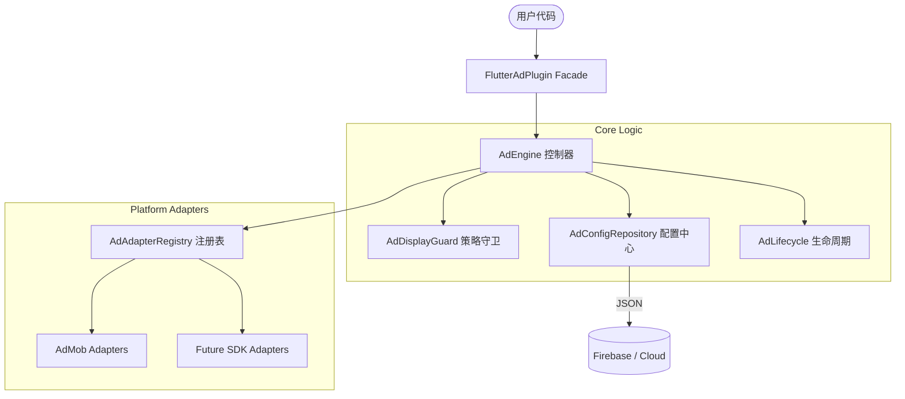

## 架构设计 (Architecture)

本项目采用了高度解耦的插件化架构，确保业务逻辑、配置管理与具体的广告平台 SDK 彻底分离。

### 架构图



### 分层说明

1. **Core (核心层)**:
   - **伪枚举系统**: 使用类包装 String（如 `PlacementType`），支持运行时动态新增广告位，无需修改插件代码。
   - **配置模型**: 定义了 `AdUnitConfig` 和 `PlacementPolicy`，所有广告行为（超时、CD、模板）均由配置驱动。

2. **Engine (引擎层)**:
   - **AdEngine**: 单例入口，负责协调预加载、展示控制和缓存管理。
   - **AdDisplayGuard**: 自动拦截违规展示请求。支持同一广告位冷却（Same CD）和全局全屏冷却（Global CD）。
   - **自动预加载**: 引擎初始化后会自动根据 `preload_list` 启动后台加载，最大化填充率。

3. **Platform (适配层)**:
   - **AdTypeAdapter**: 核心抽象接口。无论是 AdMob、AppLovin 还是 TopOn，只需实现对应的 Adapter 即可接入。
   - **泛型抹平**: 内部使用 `Object` 容器，业务层无需感知底层 SDK 的具体类（如 `AppOpenAd` 或 `InterstitialAd`）。

4. **UI (组件层)**:
   - **NativeAdView**: 统一的原生广告容器，支持根据传入的广告对象自动路由到对应的渲染逻辑。

---


## Quick start

```dart
import 'package:flutter_ad_plugin/flutter_ad_plugin.dart';
import 'package:flutter_ad_plugin/ad/analytics/ad_event_reporter.dart';
import 'package:flutter_ad_plugin/ad/config/ad_config_repository.dart';

await FlutterAdPlugin.init(
  configRepository: DefaultAdConfigRepository(),
  eventReporter: DefaultAdEventReporter(),
);

// 引擎初始化后会根据 JSON 中的 preload_list 自动开始预加载
// 直接展示即可，内部会自动等待加载完成
final shown = await FlutterAdPlugin.show(PlacementType.open);
```

## Documentation

- [接入指南](/docs/integration.md)
  - 含：初始化、埋点接入（`AdEventReporter`）、全屏/原生广告调用
- [广告配置（JSON 驱动）](/docs/ad_config.md)
- [架构说明](/docs/architecture.md)
- [时序图](/docs/sequence.md)
- [变更记录](/CHANGELOG.md)

## Native ad

```dart
await FlutterAdPlugin.loadNativeByKey('home');
final ad = FlutterAdPlugin.getNativeAdByKey('home');
if (ad != null) {
  return NativeAdView(ad: ad, height: 280);
}
```

可选：如果你不想手写字符串，也可以使用内置常量 `Placements.open/home/...`。

## Integration points

- `AdConfigRepository`: implement your own remote config source.
- `AdEventReporter`: implement your own analytics reporting.
- `AdEventType.income`: emitted from AdMob `onPaidEvent` for open, interstitial, rewarded, and native ads.
- `AdEventType.impression`: emitted from AdMob `onAdImpression`; this is exposure only, not revenue.
- `FlutterAdPlugin.initFacebookSDK(...)`: optional Meta/Facebook App Events bridge for `AD_IMPRESSION` revenue reporting.

## Example app

Run the example:

```bash
cd example
flutter pub get
flutter run
```

Reference templates:

- `example/lib/integration_templates.dart`
- `CHANGELOG.md` (`v0.1.0`)
