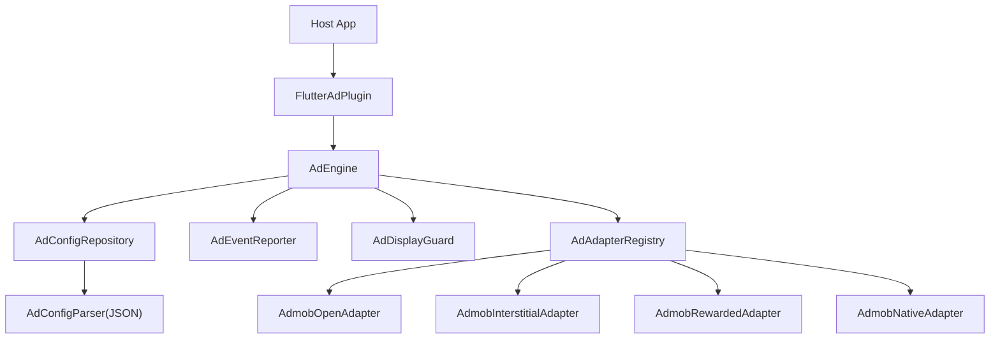
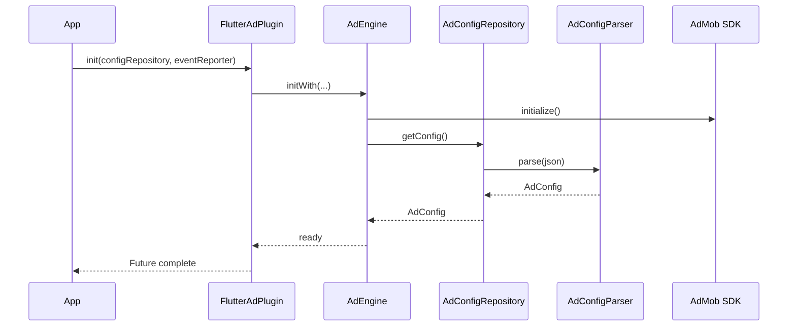
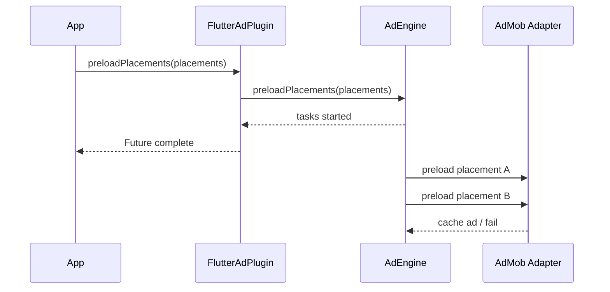
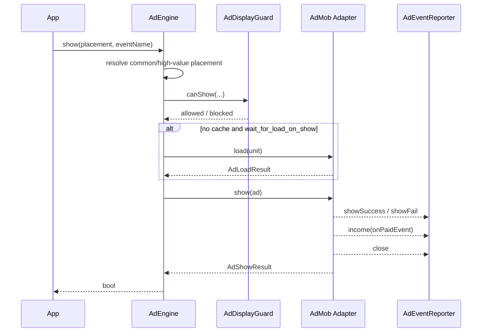
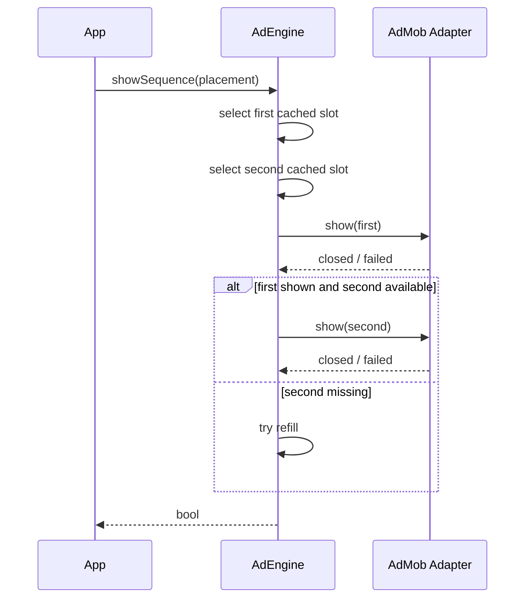
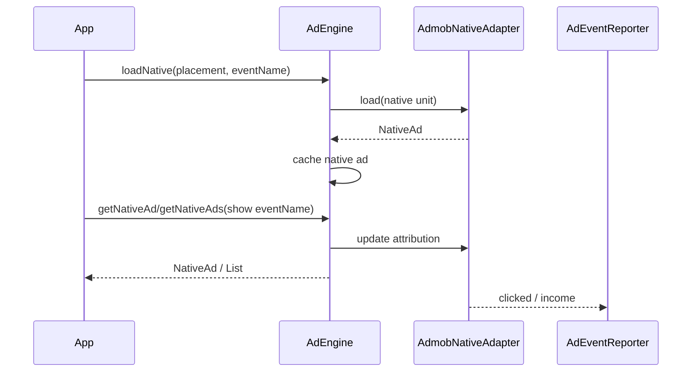
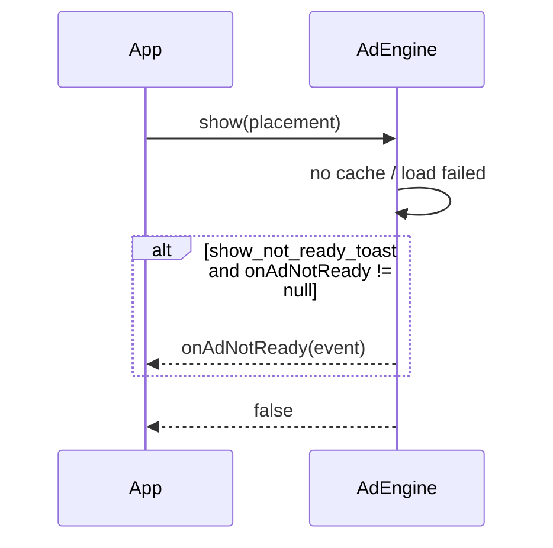

# flutter_ad_plugin

一个可复用的 Flutter 广告编排包。当前实现以 AdMob 为广告源，广告位、候选广告、缓存数量、展示策略和埋点场景都由宿主传入的 JSON / Repository 决定。

设计目标是保持 Dart 风格的小型架构：插件只做广告编排，不内置业务云控、弹窗库、埋点 SDK 或 App 生命周期监听。

## 目录

- [设计目标与能力边界](#goals)
- [快速接入](#quick-start)
- [常用 API](#api)
- [整体架构](#architecture)
- [AdMob 中介](#mediation)
- [接入指南](#integration)
- [广告配置 JSON](#ad-config)
- [展示时序](#sequence)
- [Example 与验证](#example)

<a id="goals"></a>
## 设计目标与能力边界

### 能力

- JSON 驱动广告位：新增 placement 只需要改配置，不需要改插件代码。
- 宿主注入配置：实现 `AdConfigRepository`，可以接接口、Firebase Remote Config、本地缓存或纯本地 Map。
- 宿主注入埋点：实现 `AdEventReporter`，插件只透传生命周期事件和 `eventName`。
- 支持开屏、插屏、激励、原生、双原生组合。
- 支持同广告位多 ID 缓存、公共兜底位、高价位替换、展示冷却策略。
- 预置 7 个 AdMob 中介适配器（AppLovin / Meta / Pangle / Liftoff / Mintegral / Unity / InMobi），宿主 App 开箱即用。
- `preloadPlacements()` 是 fire-and-forget，只负责发起批量预加载，不等待所有广告加载完成。

### 边界

- 插件不内置业务云控。
- 插件不内置弹窗库。
- 插件不内置 Firebase / Facebook / AppsFlyer / Adjust 等埋点 SDK。
- 插件不监听 App 前后台切换；热启动开屏由宿主接 `AppStateEventNotifier` 后调用 `show()`。
- `example/` 只是接入样例，不是插件核心架构的一部分。

<a id="quick-start"></a>
## 快速接入

### 安装

```yaml
dependencies:
  flutter_ad_plugin:
    git:
      url: git@github.com:yanmingLiu/flutter_ad_plugin.git
      ref: v0.1.0
```

### 最小代码

```dart
import 'package:flutter_ad_plugin/flutter_ad_plugin.dart';

await FlutterAdPlugin.init(
  configRepository: DefaultAdConfigRepository(localConfig: adConfigJson),
  eventReporter: MyAdEventReporter(),
  onAdNotReady: (event) {
    // 插件不依赖弹窗库。宿主按自己的 UI 体系弹 toast/snackbar/dialog。
  },
);

FlutterAdPlugin.preloadPlacements(
  const [
    PlacementType('open'),
    PlacementType('home'),
    PlacementType('message'),
  ],
  eventName: 'open_cold',
);

final shown = await FlutterAdPlugin.show(
  const PlacementType('open'),
  eventName: 'open_cold',
);
```

`eventName` 是宿主定义的广告场景。插件不生成默认值，也不规定埋点字段名，只会原样带到 `AdEvent.eventName`。

<a id="api"></a>
## 常用 API

| API | 用途 | await 语义 |
|---|---|---|
| `init()` | 注入配置、埋点和未准备回调 | 等待 SDK 与配置初始化 |
| `preload()` | 预加载单个全屏广告位 | 等待本次加载链路结束 |
| `preloadPlacements()` | 批量发起预加载 | fire-and-forget，不等加载完成 |
| `show()` | 展示单个全屏广告 | 等广告关闭或展示失败后返回 |
| `showSequence()` | 连续展示同一广告位下两个全屏缓存 | 逐个等待关闭 |
| `loadNative()` | 预加载原生广告 | 等待本次加载链路结束 |
| `getNativeAd()` | 取单个原生缓存并更新展示归因 | 同步返回 |
| `getNativeAds()` | 取多个原生缓存，用于双原生 | 同步返回 |

### 原生广告

```dart
const homePlacement = PlacementType('home');

await FlutterAdPlugin.loadNative(homePlacement, eventName: 'first_load');

final ad = FlutterAdPlugin.getNativeAd(
  homePlacement,
  eventName: 'home_show',
);

if (ad != null) {
  NativeAdView(ad: ad, height: 280);
}
```

双原生：

```dart
final ads = FlutterAdPlugin.getNativeAds(
  const PlacementType('play_middle'),
  count: 2,
  eventName: 'play_middle',
);

if (ads.length >= 2) {
  DualNativeAdView(ads: ads, height: 560);
}
```

当前 AdMob 原生广告使用 `NativeTemplateStyle`，默认不要求宿主注册自定义 `NativeAdFactory`。如果宿主要自定义原生 UI，则仍需要在 Android / iOS 宿主工程注册自己的 factory。

<a id="architecture"></a>
## 整体架构

本包按 Dart / Flutter 的轻量组织方式设计：少量公开入口，内部用小对象和函数组合完成广告编排。不要把它理解成一套业务广告系统；它只负责把宿主给出的配置、广告 SDK 和埋点回调串起来。



### Facade

`FlutterAdPlugin` 是唯一推荐给宿主使用的入口。它只保留静态方法，把调用转发给内部 `AdEngine`，避免宿主直接依赖内部类。

### Core

Core 包含三类对象：

- `PlacementType` / `AdType` / `AdSource`：用 String 包装，支持服务端动态新增 key。
- `AdConfig` / `AdUnitConfig` / `PlacementPolicy`：运行时配置模型。
- `AdConfigParser` / `AdConfigRepository`：解析 JSON 和配置来源接口。

`DefaultAdConfigRepository` 只解析传入的 `localConfig` / `localConfigJson`。远端云控、Firebase Remote Config、本地缓存等都由宿主自己实现 `AdConfigRepository`。

### Engine

`AdEngine` 是编排层，负责：

- 初始化广告 SDK 和配置。
- 按 placement 预加载广告。
- 管理全屏广告缓存和原生广告缓存。
- 处理全屏展示、连续展示、公共兜底位、高价位替换。
- 调用 `AdDisplayGuard` 做展示互斥和冷却判断。
- 生成生命周期事件并交给 `AdEventReporter`。

内部 `_AdPoolStore` 只是轻量缓存容器，不是对外服务层。

### Guard

`AdDisplayGuard` 只处理全屏广告展示约束：

- 同一时刻只允许一个全屏广告展示。
- 可按配置开启同广告位冷却。
- 可按配置开启跨广告位冷却。

`showSequence()` 按业务需要连续展示两个广告，不额外套用 CD 逻辑。

### Platform

`AdTypeAdapter` 抹平不同 SDK 的加载和展示接口。当前只注册了 AdMob：

- `AdmobOpenAdapter`
- `AdmobInterstitialAdapter`
- `AdmobRewardedAdapter`
- `AdmobNativeAdapter`

后续接 MAX / TopOn 时，新增 adapter 并注册到 `AdAdapterRegistry` 即可。

<a id="mediation"></a>
## AdMob 中介

### 已集成适配器

以下 AdMob 中介适配器已作为插件依赖预置，宿主 App **无需额外添加**即可使用：

| 广告网络 | pub.dev 包 | 版本 |
|---|---|---|
| AppLovin | `gma_mediation_applovin` | ^2.6.1 |
| Meta Audience Network | `gma_mediation_meta` | ^1.5.2 |
| Pangle | `gma_mediation_pangle` | ^3.6.0 |
| Liftoff Monetize | `gma_mediation_liftoffmonetize` | ^1.5.0 |
| Mintegral | `gma_mediation_mintegral` | ^2.1.0 |
| Unity Ads | `gma_mediation_unity` | ^1.8.0 |
| InMobi | `gma_mediation_inmobi` | ^2.1.0 |

### 工作原理

`google_mobile_ads` SDK 在运行时会自动检测并启用已安装的中介适配器。插件代码无需任何改动，加载/展示广告时 AdMob 会自动通过中介聚合多家广告网络的流量，`ad.responseInfo.loadedAdapterResponseInfo.adSourceName` 会在埋点事件中透传实际广告来源。

### Pangle 额外要求

Pangle SDK 的 Android 原生依赖托管在 Bytedance 的 Maven 仓库中，**宿主 App 需在其 `android/build.gradle`（或 `android/build.gradle.kts`）的 `allprojects.repositories` 中添加**：

```kotlin
maven {
    url = uri("https://artifact.bytedance.com/repository/pangle/")
}
```

如果不需要 Pangle，可以移除 `pubspec.yaml` 中的 `gma_mediation_pangle` 依赖。

### iOS SKAdNetwork

各适配器的 SKAdNetwork 标识符由其各自的 iOS 插件自动注入，无需手动配置 `Info.plist`。

### 中介广告位的 JSON 配置

中介广告位与普通 AdMob 广告位的 JSON 配置完全一致，只在 AdMob 后台配置中介组即可，`source` 仍为 `"admob"`：

```json
{
  "open": [
    {
      "source": "admob",
      "weight": 3,
      "type": "open",
      "id": "ca-app-pub-xxxxxxxx/xxxxxxxx"
    }
  ]
}
```

在 AdMob 后台将该广告单元配置好中介组后，AdMob 即可自动向 AppLovin / Meta / Pangle 等网络发送广告请求。

<a id="integration"></a>
## 接入指南

### 1. 准备配置仓库

本地配置可以直接使用 `DefaultAdConfigRepository`：

```dart
final repository = DefaultAdConfigRepository(localConfig: adConfigJson);
```

远端配置建议由宿主实现：

```dart
class MyConfigRepository implements AdConfigRepository {
  MyConfigRepository(this._remoteConfigService);

  final RemoteConfigService _remoteConfigService;
  AdConfig? _cache;

  @override
  Future<AdConfig> getConfig() async {
    final cached = _cache;
    if (cached != null) return cached;

    final json = await _remoteConfigService.getAdConfigJson();
    return _cache = AdConfigParser().parse(json);
  }
}
```

插件不关心配置来自接口、Firebase Remote Config、AB 实验还是本地缓存。

### 2. 准备埋点上报

```dart
class MyAdEventReporter implements AdEventReporter {
  @override
  Future<void> report(AdEvent event) async {
    final params = {
      'event_type': event.eventType.name,
      'placement': event.placementLabel ?? event.placement.name,
      'ad_type': event.adType.name,
      'source': event.source.name,
      'ad_unit_id': event.adUnitId,
      'error_code': event.errorCode,
      'error_reason': event.errorReason,
      'revenue': event.revenue,
      'currency': event.currency,
      'event_name': event.eventName,
      'timestamp': event.timestamp.toIso8601String(),
    };

    // sendToAnalytics(params);
  }
}
```

`DefaultAdEventReporter` 是空实现，只适合 demo 或临时关闭上报。正式项目建议始终注入自己的 reporter。

### 日志

默认控制台只打印失败类广告生命周期事件：

```text
[ad][event] {"event_type":"loadFailed",...}
```

完整生命周期事件仍会传给 `AdEventReporter.report()`，包括 `loadRequested`、`loadSucceeded`、`showSuccess`、`income`、`close`。正式接入建议以 reporter 为主做归因、排查和上报，不依赖控制台完整事件流。

需要本地排查完整事件和展示决策时再打开详细日志：

```dart
FlutterAdPlugin.verboseLogging = true;
```

打开后会输出完整 `[ad][event]` JSON，并额外输出 guard 拦截、无缓存、连续展示缺第二个广告、预加载耗尽或 SDK 加载失败等内部诊断。

核心事件：

| Event | 说明 |
|---|---|
| `loadRequested` | 开始请求某个广告单元 |
| `loadSucceeded` | 广告加载成功 |
| `loadFailed` | 广告加载失败 |
| `showSuccess` | 全屏广告展示成功 |
| `showFail` | 全屏广告展示失败 |
| `clicked` | 广告点击 |
| `close` | 全屏广告关闭 |
| `income` | SDK 收益回调 |

### 3. 初始化

```dart
await FlutterAdPlugin.init(
  configRepository: MyConfigRepository(remoteConfigService),
  eventReporter: MyAdEventReporter(),
  onAdNotReady: (event) {
    // 可选：根据 event.message 弹 toast/snackbar/dialog。
  },
);
```

`onAdNotReady` 只在 `placement_policy.show_not_ready_toast=true` 且无广告可展示时触发。插件不会自己弹 UI。

### 4. 冷启动预加载和开屏

```dart
FlutterAdPlugin.preloadPlacements(
  const [
    PlacementType('open'),
    PlacementType('home'),
    PlacementType('message'),
  ],
  eventName: 'open_cold',
);

await FlutterAdPlugin.show(
  const PlacementType('open'),
  eventName: 'open_cold',
);
```

`preloadPlacements()` 是 fire-and-forget。它返回时只代表预加载任务已发起，不代表广告已经加载完成。

`show()` 会等待广告关闭或展示失败后返回，适合冷启动开屏、激励广告、需要串行控制的业务流程。

### 5. 热启动开屏

插件不监听生命周期。宿主可用 AdMob 的 `AppStateEventNotifier`：

```dart
AppStateEventNotifier.startListening();
_sub = AppStateEventNotifier.appStateStream.listen((state) {
  if (state == AppState.foreground) {
    FlutterAdPlugin.show(
      const PlacementType('open'),
      eventName: 'open_hot',
    );
  }
});
```

### 6. 连续展示

```dart
final shown = await FlutterAdPlugin.showSequence(
  const PlacementType('play_middle'),
  eventName: 'play_middle',
);
```

`showSequence()` 会尽量展示两个全屏缓存。它用于需要连续广告的业务场景，不额外套用 CD 逻辑。

### 7. 原生广告

```dart
await FlutterAdPlugin.loadNative(
  const PlacementType('home'),
  eventName: 'first_load',
);

final ad = FlutterAdPlugin.getNativeAd(
  const PlacementType('home'),
  eventName: 'home_show',
);
```

`getNativeAd()` / `getNativeAds()` 会更新原生广告展示归因，用于后续 `income` 回调带出正确 `eventName`。

双原生：

```dart
final ads = FlutterAdPlugin.getNativeAds(
  const PlacementType('play_middle'),
  count: 2,
  eventName: 'play_middle',
);
```

### 8. 原生广告 UI

当前 AdMob 原生广告默认使用 `NativeTemplateStyle`，宿主不必注册自定义 factory。

如果宿主要自定义原生 UI，则需要在宿主 Android / iOS 工程注册对应 `NativeAdFactory`，并在适配器中使用匹配的 factoryId。

### 9. 常见问题

#### 为什么新增广告位不用改 Dart 代码？

`PlacementType` 是 String 包装，不是 enum。只要 JSON 有对应 placement key，插件就能解析。

#### 为什么插件不内置 Firebase Remote Config？

云控属于宿主业务基础设施。插件只需要 `AdConfigRepository`，这样不会强迫所有接入方引入 Firebase。

#### 为什么插件不自己弹 toast？

弹窗样式、路由上下文和 UI 库都属于宿主。插件只通过 `onAdNotReady` 返回上下文和文案。

#### `eventName` 和 `placement` 有什么区别？

`placement` 是广告位 key，比如 `open`、`home`、`play_middle`。`eventName` 是触发场景，比如 `open_cold`、`open_hot`、`first_load`、`home_show`。

<a id="ad-config"></a>
## 广告配置 JSON

广告配置由 `AdConfigParser` 解析。除保留字段外，顶层每个 List 节点都会被尝试识别为广告位配置。

### 完整示例

```json
{
  "load_timeout": 7,
  "same_placement_cd": 30,
  "different_placement_cd": 30,
  "common_placements": ["behavior", "behavior2"],
  "high_value_placement": "level_h",
  "placement_policy": {
    "open": {
      "is_fullscreen": true,
      "apply_same_placement_cd": true,
      "apply_different_placement_cd": true,
      "contributes_to_global_cooldown": true,
      "wait_for_load_on_show": false,
      "prefer_high_value_on_show": false
    },
    "home": {
      "is_fullscreen": false
    },
    "message": {
      "wait_for_load_on_show": true,
      "show_not_ready_toast": true,
      "not_ready_msg": "Ad is still loading, please wait a moment."
    }
  },
  "open": [
    {
      "source": "admob",
      "weight": 3,
      "type": "open",
      "id": "ca-app-pub-3940256099942544/5575463023"
    },
    {
      "source": "admob",
      "weight": 2,
      "type": "interstitial",
      "id": "ca-app-pub-3940256099942544/4411468910"
    }
  ],
  "home": [
    {
      "source": "admob",
      "weight": 1,
      "type": "native",
      "id": "ca-app-pub-3940256099942544/3986624511",
      "id2": "ca-app-pub-3940256099942544/2521693316",
      "template_type": "medium",
      "refresh_minutes": 20
    }
  ],
  "play_middle": [
    {
      "ad_source": "admob",
      "ad_weight": 2,
      "ad_type": "interstitial",
      "ad_id": "ca-app-pub-3940256099942544/1033173712"
    },
    {
      "ad_source": "admob",
      "ad_weight": 1,
      "ad_type": "double_native",
      "ad_id": "ca-app-pub-3940256099942544/1044960115",
      "ad_id2": "ca-app-pub-3940256099942544/1044960115"
    }
  ]
}
```

### 顶层字段

| 字段 | 类型 | 默认值 | 说明 |
|---|---|---|---|
| `load_timeout` | number | `7` | 单个广告单元加载超时，单位秒 |
| `same_placement_cd` | number | `30` | 同广告位展示冷却，单位秒 |
| `different_placement_cd` | number | `30` | 跨广告位展示冷却，单位秒 |
| `common_placements` | string[] | `["behavior", "behavior2"]` | 请求未配置广告位时的兜底广告位列表 |
| `high_value_placement` | string | `level_h` 如果存在 | 高价值全屏广告位 |
| `placement_policy` | object | 自动推导 | 展示策略 |

### 广告单元字段

| 字段 | 别名 | 说明 |
|---|---|---|
| `source` | `ad_source` | 广告源，当前实现 `admob` |
| `type` | `ad_type` | 广告类型：`open` / `interstitial` / `rewarded` / `native` / `double_native` |
| `weight` | `ad_weight` | 权重，数值越大越优先尝试 |
| `id` | `ad_id` | 广告单元 ID |
| `id2` | `ad_id2` | 第二个广告单元 ID |
| `id3...` | - | 更多编号 ID，按数字顺序解析 |
| `ids` | - | 数组形式的多个广告单元 ID |
| `load_timeout` | - | 覆盖当前广告单元加载超时 |
| `template_type` | - | AdMob native template 类型：`small` / `medium` |
| `refresh_minutes` | - | 原生广告缓存自动刷新间隔 |

`id`、`id2`、`id3...`、`ids` 会展开成多个 `AdUnitConfig`。同一个 placement 因此可以缓存多个广告对象，`getNativeAds(..., count: 2)` 会从缓存里取多个原生广告。

### placement_policy

| 字段 | 默认值 | 说明 |
|---|---|---|
| `is_fullscreen` | 根据候选类型推导 | 是否进入全屏展示链路 |
| `apply_same_placement_cd` | `false` | 是否启用同广告位冷却 |
| `apply_different_placement_cd` | `false` | 是否启用跨广告位冷却 |
| `contributes_to_global_cooldown` | `false` | 成功展示后是否写入全局冷却时间 |
| `show_not_ready_toast` | `false` | 无广告可展示时是否触发 `onAdNotReady` |
| `not_ready_msg` | 默认英文文案 | 传给 `onAdNotReady` 的建议文案 |
| `wait_for_load_on_show` | 非 open 默认为 `true` | `show()` 无缓存时是否等待加载 |
| `prefer_high_value_on_show` | 非 open 默认为 `true` | 展示固定广告位时是否优先尝试高价位缓存 |
| `allowed_types` | 空 | 限定当前 placement 允许的广告类型 |

### 默认推导规则

- placement 中只要包含全屏类型，默认 `is_fullscreen=true`。
- `open` 默认 `wait_for_load_on_show=false`、`prefer_high_value_on_show=false`。
- 其他 placement 默认 `wait_for_load_on_show=true`、`prefer_high_value_on_show=true`。
- `allowed_types` 不配置时，全屏 placement 支持全屏和原生候选，非全屏 placement 只支持原生候选。

### 公共兜底位

当调用 `show(search)` 或 `preload(search)`，但 JSON 没有配置 `search` 时，插件会按 `common_placements` 顺序查找第一个已配置的公共广告位。

### 高价位替换

当固定 placement 可展示时，如果 `prefer_high_value_on_show=true` 且 `high_value_placement` 有可用全屏缓存，插件会优先展示高价位缓存。

埋点仍以上层调用传入的 placement / eventName 为准，方便业务侧按触发场景统计。

### double_native

`double_native` 表示双原生候选类型，用于配置两个原生广告 ID。它不是一个必须固定存在的 placement 名。

使用方式：

```dart
final ads = FlutterAdPlugin.getNativeAds(
  const PlacementType('play_middle'),
  count: 2,
  eventName: 'play_middle',
);
```

### 推荐配置

`placement_policy` 中的开屏策略：

```json
{
  "open": {
    "is_fullscreen": true,
    "apply_same_placement_cd": true,
    "apply_different_placement_cd": true,
    "contributes_to_global_cooldown": true,
    "wait_for_load_on_show": false,
    "prefer_high_value_on_show": false
  }
}
```

`placement_policy` 中的激励 / 消息奖励策略：

```json
{
  "message": {
    "is_fullscreen": true,
    "wait_for_load_on_show": true,
    "show_not_ready_toast": true,
    "not_ready_msg": "Ad is still loading, please wait a moment."
  }
}
```

`placement_policy` 中的原生策略：

```json
{
  "home": {
    "is_fullscreen": false
  }
}
```

<a id="sequence"></a>
## 展示时序

### 初始化



### 批量预加载



`preloadPlacements()` 不等待所有 adapter 加载完成。需要等待明确结果时，用 `preload()` 或 `loadNative()`。

### 单个全屏广告展示



`show()` 会阻塞到广告关闭或展示失败。

### 连续展示



`showSequence()` 用于明确需要连续广告的业务场景，不额外套用 CD 逻辑。

### 原生广告



原生广告收入回调可能晚于 `loadNative()`。因此插件在 `getNativeAd()` / `getNativeAds()` 时更新归因，让后续 `income` 带出展示场景的 `eventName`。

### 未准备提示



插件只回调 `onAdNotReady`，不直接弹 toast。

<a id="example"></a>
## Example 与验证

### Example

```bash
cd example
flutter pub get
flutter run
```

示例配置和 reporter 模板见 `example/lib/integration_templates.dart`。

### 验证

```bash
flutter analyze
flutter test
```
