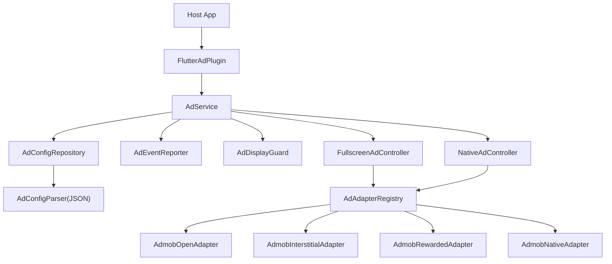
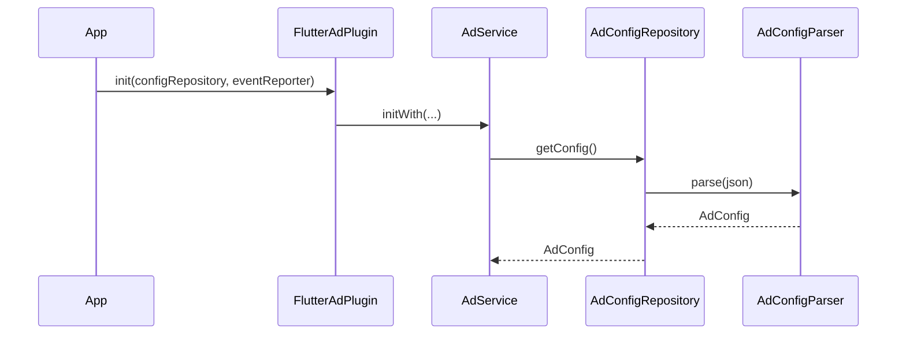
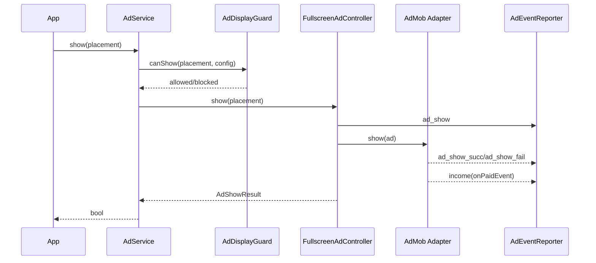
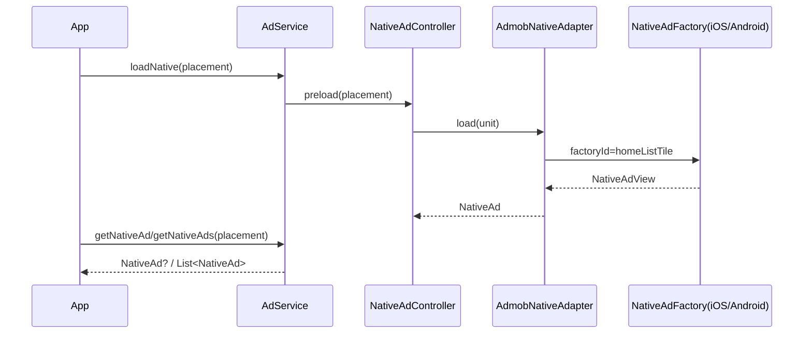

## 架构设计 (Architecture)

本项目采用了高度解耦的插件化架构，确保业务逻辑、配置管理与具体的广告平台 SDK 彻底分离。

配置与策略由 JSON 驱动，埋点由宿主注入。

### 架构图



### 分层说明

1. **Core (核心层)**:
   - **伪枚举系统**: 使用类包装 String（如 `PlacementType`），支持运行时动态新增广告位，无需修改插件代码。
   - **配置模型**: 定义了 `AdUnitConfig` 和 `PlacementPolicy`，所有广告行为（超时、CD、模板）均由配置驱动。

2. **Engine (引擎层)**:
   - **AdEngine**: 单例入口，负责协调预加载、展示控制和缓存管理。
   - **AdDisplayGuard**: 自动拦截违规展示请求。支持同一广告位冷却（Same CD）和全局全屏冷却（Global CD）。
   - **自动预加载**: 引擎初始化后会自动根据 `preload_list` 启动后台加载，最大化填充率。

3. **Platform (适配层)**:
   - **AdTypeAdapter**: 核心抽象接口。无论是 AdMob、AppLovin 还是 TopOn，只需实现对应的 Adapter 即可接入。
   - **泛型抹平**: 内部使用 `Object` 容器，业务层无需感知底层 SDK 的具体类（如 `AppOpenAd` 或 `InterstitialAd`）。

4. **UI (组件层)**:
   - **NativeAdView**: 统一的原生广告容器，支持根据传入的广告对象自动路由到对应的渲染逻辑。

### 动态规则

`AdConfigParser` 解析 JSON 后，运行时按配置动态决策：

- placement 候选能力：从该 placement 的 `type` 列表推导
- 展示策略：优先读 `placement_policy`，否则按候选类型推导默认值

这意味着宿主主要通过 JSON 控制行为，不再需要维护静态能力/策略表。

### iOS/Android 原生广告

- Android：`HomeNativeAdFactory.kt`
- iOS：`HomeNativeAdFactory.swift`
- 统一 `factoryId = homeListTile`

---

## Quick Start

```dart
import 'package:flutter_ad_plugin/flutter_ad_plugin.dart';
import 'package:flutter_ad_plugin/ad/analytics/ad_event_reporter.dart';
import 'package:flutter_ad_plugin/ad/config/ad_config_repository.dart';

await FlutterAdPlugin.init(
  configRepository: DefaultAdConfigRepository(),
  eventReporter: DefaultAdEventReporter(),
);

// 引擎初始化后会根据 JSON 中的 preload_list 自动开始预加载
// 直接展示即可，内部会自动等待加载完成
const openPlacement = PlacementType('open');
final shown = await FlutterAdPlugin.show(openPlacement, eventName: 'open_cold');
```

### 自定义事件名 (eventName)

`preload()`、`show()`、`loadNative()` 均支持可选的 `eventName` 参数。宿主调用时传入当前上下文（如冷/热启动），`AdEvent` 会原样带出到 reporter，用于埋点区分场景：

```dart
// 冷启动开屏
await FlutterAdPlugin.show(openPlacement, eventName: 'open_cold');

// 热启动开屏（从后台返回）
await FlutterAdPlugin.show(openPlacement, eventName: 'open_hot');

// 冷启动期间预加载其他广告位
await FlutterAdPlugin.preload(homePlacement, eventName: 'cold_load');

// 新用户首次加载原生广告
await FlutterAdPlugin.loadNative(homePlacement, eventName: 'first_load');
```

reporter 中通过 `event.eventName` 获取：
```dart
print('event=${event.eventName}'); // 'open_cold' / 'open_hot' / 'cold_load' ...
```

### 热启动开屏（App 前后台切换）

插件不再内置生命周期监听，宿主通过 AdMob `AppStateEventNotifier` 自行处理。

参考 demo 中的 `AdLifecycle` 封装：

```dart
import 'dart:async';
import 'package:google_mobile_ads/google_mobile_ads.dart';

class AdLifecycle {
  AdLifecycle({required this.onForeground});

  final void Function() onForeground;
  StreamSubscription<AppState>? _sub;

  void start() {
    AppStateEventNotifier.startListening();
    _sub = AppStateEventNotifier.appStateStream.listen((state) {
      if (state == AppState.foreground) {
        onForeground();
      }
    });
  }

  void dispose() {
    _sub?.cancel();
    _sub = null;
  }
}
```

在页面中使用：

```dart
class HomePageState extends State<HomePage> {
  late final AdLifecycle _lifecycle;

  @override
  void initState() {
    super.initState();
    _lifecycle = AdLifecycle(onForeground: () {
      FlutterAdPlugin.show(openPlacement, eventName: 'open_hot');
    });
    _lifecycle.start();
  }

  @override
  void dispose() {
    _lifecycle.dispose();
    super.dispose();
  }
}
```

> `AppStateEventNotifier` 能精准识别前后台切换，自动处理广告关闭导致的回弹问题（比 `WidgetsBindingObserver` 更准确）。`AdDisplayGuard` 内置 CD 冷却，频繁切换也不会重复展示。

---

## 接入指南

### 1) 依赖接入

```yaml
dependencies:
  flutter_ad_plugin:
    git:
      url: git@github.com:yanmingLiu/flutter_ad_plugin.git
      ref: v0.1.0
```

### 2) 初始化（注入配置和埋点）

```dart
await FlutterAdPlugin.init(
  configRepository: MyConfigRepository(),
  eventReporter: MyAdEventReporter(),
);
```

如果需要把广告收入同步到 Meta/Facebook App Events，先在宿主云控拿到 Facebook `appId` / `clientToken` 后初始化：

```dart
await FlutterAdPlugin.initFacebookSDK(
  appId: facebookAppIdFromRemoteConfig,
  clientToken: facebookClientTokenFromRemoteConfig,
);
```

初始化时机建议：

- 先完成云控拉取，再调用 `initFacebookSDK`
- 不要在 paid 回调里临时初始化 Facebook SDK
- 如果开屏广告收入回调早于 SDK 初始化完成，默认实现会缓存最多 50 条收入事件，初始化成功后 flush

### 埋点接入

插件不会绑定具体埋点平台，宿主项目需要实现 `AdEventReporter` 并在初始化时注入。

```dart
import 'package:flutter_ad_plugin/ad/analytics/ad_event.dart';
import 'package:flutter_ad_plugin/ad/analytics/ad_event_reporter.dart';

class MyAdEventReporter implements AdEventReporter {
  @override
  Future<void> report(AdEvent event) async {
    final placement = event.placementLabel ?? event.placement;
    final params = {
      'event_type': event.eventType.name,
      'placement': placement,
      'ad_type': event.adType.name,
      'source': event.source.name,
      'ad_unit_id': event.adUnitId,
      'error_code': event.errorCode,
      'error_reason': event.errorReason,
      'revenue': event.revenue,
      'currency': event.currency,
      'ts': event.timestamp.toIso8601String(),
      'event_name': event.eventName,
    };

    // TODO: 映射到你的埋点系统（Firebase / AppsFlyer / Adjust / 自研）
    // sendToAnalytics(params);
  }
}
```

当前会回调的核心事件类型（`AdEventType`）：

- `loadRequested`
- `loadSucceeded`
- `loadFailed`
- `show`
- `showSuccess`
- `showFail`
- `impression`
- `clicked`
- `close`
- `rewardEarned`
- `income`
- `blockedByGuard`

埋点建议：

- 失败事件（`loadFailed/showFail`）务必上报 `error_code`、`error_reason`
- 收益事件（`income`）来自 `onPaidEvent`，务必上报 `revenue`、`currency`、`ad_unit_id`
- `revenue` 保留 AdMob 回调的 `valueMicros` 原始值；发给 Meta/Facebook `AD_IMPRESSION` 时再除以 `1000000`
- `impression` 来自 `onAdImpression`，只代表曝光发生，不带金额和币种，不能替代广告收入埋点
- 业务广告位建议优先使用 `placementLabel`，未传时回退 `placement`

默认 `DefaultAdEventReporter` 会额外尝试通过 `facebook_sdk_init` MethodChannel 发送 Meta/Facebook 标准事件：

- method: `initializeFbSDK`
- method: `logAdImpression`
- event: `AppEventsConstants.EVENT_NAME_AD_IMPRESSION`
- currency param: `AppEventsConstants.EVENT_PARAM_CURRENCY`
- 当前仓库内置 Android 示例桥接；iOS 宿主需要按同样 MethodChannel 约定接入 FBSDKCoreKit

如果宿主使用自定义 `AdEventReporter`，也可以直接在 `AdEventType.income` 里自行接 Firebase / AppsFlyer / Adjust / 自研 BI / Meta App Events。

### 3) 开屏/全屏广告

```dart
const openPlacement = PlacementType('open');
await FlutterAdPlugin.preload(openPlacement, eventName: 'open_cold');
final shown = await FlutterAdPlugin.show(openPlacement, eventName: 'open_cold');
```

> `show()` 会阻塞直到用户关闭广告（或展示失败）才返回。冷启动开屏应放在启动页 `initState` 中 await，确保广告关闭后再进入主页。

#### 连续展示多个全屏广告

一个 placement 通过 `id`/`id2` 配置多个同类型广告单元 ID 时，引擎会为展开的每个 ID 加载并缓存独立广告对象（`poolSize` = ID 数量）。`show()` 每次消费一个，等用户关闭后 `await` 返回，再调用下一个：

```json
"double_ad": [
  { "source": "admob", "weight": 1, "type": "rewarded",
    "id": "ca-app-pub-3940256099942544/1712485313",
    "id2": "ca-app-pub-3940256099942544/6978759866" }
]
```

```dart
const doubleAdPlacement = PlacementType('double_ad');
final firstShown = await FlutterAdPlugin.show(
  doubleAdPlacement,
  eventName: 'double_ad_1',
);
if (!firstShown) return;
await FlutterAdPlugin.show(
  doubleAdPlacement,
  eventName: 'double_ad_2',
);
```

> 关键：`id2` 展开使 `poolSize=2`，引擎加载两个广告；`show()` 等待 dismiss 才返回，所以两次 await 自然形成"关闭→弹出"的序列。

### 4) 原生广告

```dart
const homePlacement = PlacementType('home');
await FlutterAdPlugin.loadNative(homePlacement, eventName: 'first_load');
final ad = FlutterAdPlugin.getNativeAd(homePlacement);
if (ad != null) {
  NativeAdView(ad: ad, height: 280);
}
```

如果一个广告位配置了多个原生广告 ID，可以取多个缓存结果做组合展示：

```dart
const homePlacement = PlacementType('home');
await FlutterAdPlugin.loadNative(homePlacement, eventName: 'first_load');
final ads = FlutterAdPlugin.getNativeAds(homePlacement, count: 2);
if (ads.length >= 2) {
  DualNativeAdView(ads: ads, height: 560);
}
```

### 5) 只传 JSON 的实现方式

`MyConfigRepository` 内部直接解析 JSON：

```dart
class MyConfigRepository implements AdConfigRepository {
  @override
  Future<AdConfig> getConfig() async {
    final json = ...; // remote/local json map
    return AdConfigParser().parse(json);
  }
}
```

你只需要维护 JSON 即可决定：

- 广告位（placement key）
- 候选广告类型与权重
- 冷却策略和提示策略（`placement_policy`）

### 6) 新增广告位

当前版本已支持纯字符串广告位：新增 placement key 只需要在 JSON 中新增对应节点，不需要再改插件源码映射表。

---

## 广告配置（JSON 驱动）

插件通过 JSON 决定广告位、广告类型候选、权重、加载超时、频控与展示策略。默认实现与 example 使用同一份结构。

### 完整示例

```json
{
  "load_timeout": 7,
  "same_placement_cd": 30,
  "different_placement_cd": 30,
  "placement_policy": {
    "open": {
      "is_fullscreen": true,
      "apply_same_placement_cd": true,
      "apply_different_placement_cd": true,
      "contributes_to_global_cooldown": true,
      "show_not_ready_toast": false
    },
    "home": {
      "is_fullscreen": false,
      "apply_same_placement_cd": false,
      "apply_different_placement_cd": false,
      "contributes_to_global_cooldown": false,
      "show_not_ready_toast": false
    }
  },
  "open": [
    { "source": "admob", "weight": 3, "type": "open", "id": "ca-app-pub-3940256099942544/5575463023", "id2": "ca-app-pub-3940256099942544/5575463023" },
    { "source": "admob", "weight": 2, "type": "interstitial", "id": "ca-app-pub-3940256099942544/4411468910" },
    { "source": "admob", "weight": 1, "type": "rewarded", "id": "ca-app-pub-3940256099942544/1712485313" }
  ],
  "home": [
    { "source": "admob", "weight": 1, "type": "native", "ids": ["ca-app-pub-3940256099942544/1044960115", "ca-app-pub-3940256099942544/1044960115"] }
  ],
  "message": [
    { "source": "admob", "weight": 2, "type": "interstitial", "id": "ca-app-pub-3940256099942544/4411468910", "load_timeout": 15 }
  ]
}
```

### 字段说明

- 顶层 `load_timeout`：全局单次加载超时（秒）。
- `same_placement_cd`：同广告位冷却（秒）。
- `different_placement_cd`：跨广告位冷却（秒）。
- `<placement_key>`：广告位键（如 `open`、`home`、`message`）。
- `source`：广告源（当前实现 `admob`）。
- `type`：广告类型（`open/interstitial/rewarded/native`）。
- `weight`：候选权重，越大越优先。
- `id`：广告单元 ID。
- `id2/id3...`：同一个配置项下的额外广告单元 ID，插件会展开为多个可缓存广告。
- `ids`：数组形式的额外广告单元 ID，适合配置多个 ID；可与 `id` 混用。
- 单条 `load_timeout`：覆盖当前广告配置项的加载超时；未配置时回退顶层 `load_timeout`。

同一个广告位如果配置了多个 ID，插件会尽量缓存多个广告对象。`getNativeAd(...)` 仍返回第一个广告；需要双原生广告时使用 `getNativeAds(..., count: 2)`。

### `placement_policy`（可选）

按广告位键覆盖策略：

| 字段 | 说明 |
|---|---|
| `is_fullscreen` | `true` 时进入全屏展示互斥与冷却链路；`false` 时按非全屏位处理（常见于 `native`） |
| `apply_same_placement_cd` | `true` 时，同一个 placement 在冷却窗口内重复触发会被拦截 |
| `apply_different_placement_cd` | `true` 时，如果刚展示过其他 placement 的全屏广告，在跨位冷却窗口内会被拦截 |
| `contributes_to_global_cooldown` | `true` 时，该 placement 成功展示后会影响其他开启跨位冷却的 placement |
| `show_not_ready_toast` | `true` 时，未命中缓存/加载失败场景可弹提示；`false` 时静默失败 |

推荐实践：

- `open/chatBack/chatSession` 这类入口拦截位，通常配置为：`is_fullscreen=true`、`apply_same_placement_cd=true`、`apply_different_placement_cd=true`、`contributes_to_global_cooldown=true`。
- `message/liveVideo` 这类高频触发位，通常按业务体验降低限制：可关闭同位/跨位冷却，按需开启 `show_not_ready_toast`。
- `home` 原生位通常配置为：`is_fullscreen=false`，并关闭冷却相关字段。

未配置时，插件按候选广告类型自动推导默认策略：

- 含 `native` 的 placement 默认视为非全屏
- 纯全屏类型 placement 默认启用全屏相关策略

### 配置入口

- 默认仓库：`DefaultAdConfigRepository`
- 自定义实现：实现 `AdConfigRepository`
- 默认仓库支持传入 `localConfig` / `localConfigJson` 作为本地兜底配置
- Firebase Remote Config 的 `ad_config_json` 有有效内容时会覆盖本地配置并更新 `_cached`
- 默认仓库会监听实时云控更新；如果更新包含 `ad_config_json`，`activate()` 后重新解析并替换缓存配置
- 插件不内置任何广告位；本地兜底和云控 JSON 都由宿主提供

---

## 时序图

### 初始化与配置解析



### 全屏广告展示



### 原生广告



---

## Integration Points

- `AdConfigRepository`: implement your own remote config source.
- `AdEventReporter`: implement your own analytics reporting (Firebase, Facebook, AppsFlyer, etc.).
- `AdEventType.income`: emitted from AdMob `onPaidEvent` for all ad types.
- `AdEventType.impression`: emitted from AdMob `onAdImpression`.
- `AdEvent.eventName`: caller-defined event label, passed through from `show()`/`preload()`/`loadNative()`.

---

## Example App

Run the example:

```bash
cd example
flutter pub get
flutter run
```

Reference templates:

- `example/lib/integration_templates.dart`
- `CHANGELOG.md` (`v0.1.0`)
