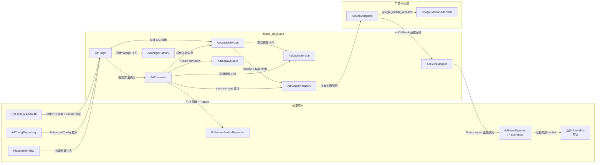
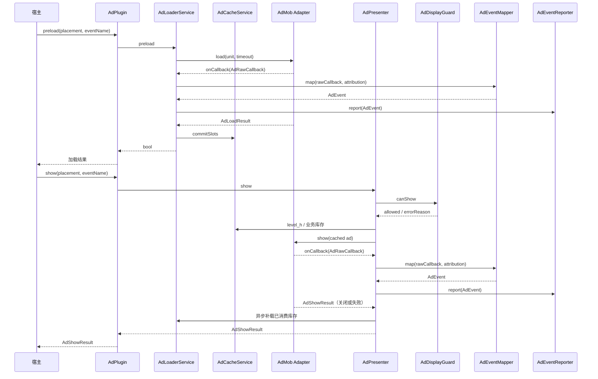
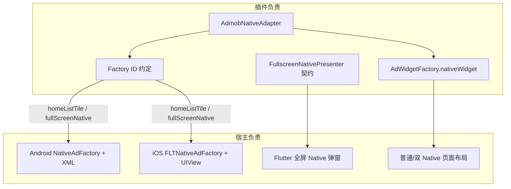

# flutter_ad_plugin

一个由 JSON 配置驱动的 Flutter 广告编排插件。插件负责 AdMob 广告的加载、缓存、瀑布流、全屏展示策略、冷却控制、事件归因和资源释放；业务配置、Native UI、页面布局和埋点平台由宿主应用负责。

当前版本：`0.1.0`

Dart SDK：`^3.10.0`

AdMob Flutter SDK：`google_mobile_ads ^9.2.0`
MAX Flutter SDK：`applovin_max ^4.6.4`

## 能力与边界

插件提供：

- 开屏、插屏、激励、插页式激励、Native、双 Native 和 Banner。
- 动态 `PlacementType`，新增广告位不需要修改插件枚举。
- JSON 配置、按权重执行的瀑布流和同广告位多 ID 缓存。
- `level_h` 公共高价库存与 `behavior`、`behavior2` 公共全屏库存。
- 全屏广告统一互斥和 `ad_cd` 冷却。
- `eventName` 全链路事件归因。
- Native 多场景独立缓存，通过 `cacheId` 隔离。
- 加载超时、取消、晚到广告释放和插件销毁清理。

宿主应用负责：

- 提供本地或远程 JSON 配置。
- 实现 `AdEventReporter` 并接入业务埋点平台。
- 监听前后台生命周期并决定冷启动、热启动展示时机。
- 在 Android/iOS 注册 Native Factory 和实现原生 Native UI。
- 注入全屏 Native 的 Flutter 展示界面。
- 决定普通 Native、双 Native 和 Banner 在页面中的布局。

插件不会自动刷新 Native 或 Banner。Banner 是否自动刷新由 AdMob 后台配置决定；Native 如需刷新，由业务方重新调用加载接口。

## 整体架构



组件职责：

| 组件 | 职责 |
|---|---|
| `AdPlugin` | 对外入口、依赖装配和实例生命周期 |
| `AdLoaderService` | 广告位解析、瀑布流、加载去重、超时和补载 |
| `AdPresenter` | 库存选择、高价替换、单次/双轮展示和结果组装 |
| `AdDisplayGuard` | 全屏互斥和 `ad_cd` 冷却 |
| `AdCacheService` | 按 placement/cacheId 保存广告及事件归因 |
| `AdAdapterRegistry` | 按 `source + type` 查找平台 Adapter |
| `AdEventMapper` | 将 SDK 原始回调转换为统一 `AdEvent` |
| `AdWidgetFactory` | 提供单个 Native/Banner 的薄 Widget 渲染桥 |

### 层间通信方式

| 调用方向 | 通信方式 | 是否 EventBus |
|---|---|---|
| 宿主 -> `AdPlugin` | 直接方法调用；异步操作通过 `Future` 返回 | 否 |
| `AdPlugin` -> Loader/Presenter | 构造函数依赖注入后的直接调用 | 否 |
| Loader/Presenter -> `AdConfigRepository` | `Future<AdConfig>` 拉取配置 | 否 |
| Loader/Presenter -> Cache/Guard/Registry | 实例方法调用，共享当前插件实例内的内存状态 | 否 |
| Adapter -> Loader/Presenter | `AdLoadResult` / `AdShowResult` Future，加 `onCallback` 生命周期回调 | 否 |
| Loader/Presenter -> `AdEventMapper` | 同步转换 `AdRawCallback -> AdEvent` | 否 |
| Loader/Presenter -> `AdEventReporter` | 调用宿主注入的 `Future<void> report(AdEvent)` | 否 |
| Presenter -> 全屏 Native UI | 调用宿主注入的 `FullscreenNativePresenter` 函数并等待 Future | 否 |

当前架构刻意不使用全局 EventBus。广告事件由当前 `AdPlugin` 实例沿显式回调链路上报，避免跨实例串事件、隐式订阅生命周期和未注销监听造成的泄漏。宿主如果已经有 EventBus，可以在自己的 `AdEventReporter.report()` 中把 `AdEvent` 发布到业务 EventBus；插件不直接依赖具体 EventBus 实现。

```dart
class BusinessAdEventReporter implements AdEventReporter {
  BusinessAdEventReporter(this.eventBus);

  final BusinessEventBus eventBus;

  @override
  Future<void> report(AdEvent event) async {
    eventBus.publish(event);
  }
}
```

加载和展示的主路径：



## Native UI 边界



插件产物不包含具体 Native Factory、平台布局资源或全屏弹窗。Example 只是宿主实现参考，业务方可以保持默认 Factory ID，也可以通过 JSON `factory_id` 使用自己的 ID。

## 安装

本仓库采用解耦子包架构，宿主项目可**按需引入**所需广告平台（例如只接 AdMob + MAX 时，无需打包 TopOn 及其庞大原生 SDK）：

### 推荐：按需接入（只接 AdMob + MAX）

```yaml
dependencies:
  # 核心调度引擎（瀑布流、缓存、冷却、事件归因，0 广告平台 SDK 依赖）
  flutter_ad_core:
    git:
      url: https://github.com/yanmingLiu/flutter_ad_plugin.git
      path: packages/flutter_ad_core
      ref: main

  # AdMob 适配器
  flutter_ad_admob:
    git:
      url: https://github.com/yanmingLiu/flutter_ad_plugin.git
      path: packages/flutter_ad_admob
      ref: main

  # AppLovin MAX 适配器
  flutter_ad_max:
    git:
      url: https://github.com/yanmingLiu/flutter_ad_plugin.git
      path: packages/flutter_ad_max
      ref: main

  # 如需 TopOn (secmtp_sdk)，按需取消注释：
  # flutter_ad_topon:
  #   git:
  #     url: https://github.com/yanmingLiu/flutter_ad_plugin.git
  #     path: packages/flutter_ad_topon
  #     ref: main
```

### 完整引入（兼容旧版全量包）

```yaml
dependencies:
  flutter_ad_plugin:
    git:
      url: https://github.com/yanmingLiu/flutter_ad_plugin.git
      ref: main
```

---

## 广告源 (Mediation Networks) 集成说明

> **重要原则**：AdMob / MAX 的各聚合广告源（如 Meta, Mintegral, Pangle, Unity, InMobi 等）属于原生依赖，**均在宿主 App 原生层按需配置**，插件层不写死捆绑，避免所有项目强制背负不需要的 SDK 包体积和隐私权限。

### 1. Android 配置 (`android/app/build.gradle.kts` 或 `build.gradle`)
在宿主项目的 `dependencies` 中添加需要的 Mediation Adapters：

```kotlin
dependencies {
    // AdMob Mediation 示例 (按需引入)
    implementation("com.google.ads.mediation:pangle:6.4.0.6.0")
    implementation("com.google.ads.mediation:facebook:6.18.0.0")
    implementation("com.google.ads.mediation:mintegral:16.8.61.0")
    implementation("com.google.ads.mediation:applovin:13.1.0.0")

    // MAX Mediation 示例 (按需引入)
    // implementation("com.applovin.mediation:bytedance-adapter:6.4.0.6.0")
    // implementation("com.applovin.mediation:google-adapter:23.6.0.0")
}
```

并在 `AndroidManifest.xml` 中配置主平台的 App ID / Key：
```xml
<application>
    <!-- AdMob App ID -->
    <meta-data
        android:name="com.google.android.gms.ads.APPLICATION_ID"
        android:value="ca-app-pub-xxxxxxxxxxxxxxxx~yyyyyyyyyy"/>
    <!-- MAX SDK Key (如果使用) -->
    <meta-data
        android:name="applovin.sdk.key"
        android:value="YOUR_APPLOVIN_SDK_KEY"/>
</application>
```

### 2. iOS 配置 (`ios/Podfile`)
在宿主项目的 `ios/Podfile` 中添加对应的 Pods：

```ruby
target 'Runner' do
  use_frameworks!
  flutter_install_all_ios_pods File.dirname(File.realpath(__FILE__))

  # AdMob Mediation 示例 (按需引入)
  pod 'GoogleMobileAdsMediationPangle'
  pod 'GoogleMobileAdsMediationFacebook'
  pod 'GoogleMobileAdsMediationMintegral'
  pod 'GoogleMobileAdsMediationAppLovin'

  # MAX Mediation 示例 (按需引入)
  # pod 'AppLovinMediationByteDanceAdapter'
  # pod 'AppLovinMediationGoogleAdapter'
end
```

并在 `Info.plist` 中配置 `GADApplicationIdentifier` 与 `AppLovinSdkKey`。

## 快速接入

下面示例假设宿主已经实现并注册 Native Factory，并从 Example 复制了 `FullscreenNativeAdDialog`：

```dart
import 'dart:async';

import 'package:flutter/material.dart';
import 'package:flutter_ad_plugin/flutter_ad_plugin.dart';

import 'fullscreen_native_ad_dialog.dart';

late final AdPlugin adPlugin;

Future<void> initializeAds() async {
  adPlugin = AdPlugin(
    config: AdPluginConfig(
      configRepository: DefaultAdConfigRepository(localConfig: adConfigJson),
      eventReporter: MyAdEventReporter(),
      fullscreenNativePresenter: FullscreenNativeAdDialog.show,
      onAdNotReady: (event) {
        // 宿主按自己的 UI 体系提示用户。
      },
      verboseLogging: true,
    ),
  );

  await adPlugin.init();

  // 等待所有指定广告位完成本轮加载。
  await adPlugin.preloadPlacements(
    const [
      PlacementType('open'),
      PlacementType('behavior'),
      PlacementType('behavior2'),
      PlacementType('home'),
      PlacementType('play_middle'),
      PlacementType('bottom_banner'),
    ],
    eventName: 'cold_start',
  );
}

Future<AdShowResult> showColdOpen(BuildContext context) {
  return adPlugin.show(
    const PlacementType('open'),
    context: context,
    eventName: 'open_cold',
  );
}
```

如果冷启动不希望等待全部广告，可以由业务方显式后台执行：

```dart
unawaited(
  adPlugin.preloadPlacements(
    coldStartPlacements,
    eventName: 'cold_start',
  ),
);
```

此时 fire-and-forget 是宿主的调用方式，不是 `preloadPlacements()` 自身的返回语义。

## JSON 配置

### 完整示例

```dart
final adConfigJson = <String, dynamic>{
  'ad_cd': 30,
  'load_timeout': 7,
  'rewarded_load_timeout': 20,
  'common_placements': ['behavior', 'behavior2'],
  'high_value_placement': 'level_h',
  'open': [
    {'source': 'admob', 'weight': 4, 'type': 'native', 'ad_id': ids.native},
    {'source': 'admob', 'weight': 3, 'type': 'open', 'ad_id': ids.open},
    {
      'source': 'admob',
      'weight': 2,
      'type': 'interstitial',
      'ad_id': ids.interstitial,
    },
    {'source': 'admob', 'weight': 1, 'type': 'rewarded', 'ad_id': ids.rewarded},
  ],
  'home': [
    {'source': 'admob', 'weight': 1, 'type': 'native', 'ad_id': ids.native},
  ],
  'behavior': [
    {
      'ad_source': 'admob',
      'ad_weight': 1,
      'ad_type': 'interstitial',
      'ad_id': ids.interstitial,
    },
  ],
  'behavior2': [
    {'ad_source': 'admob', 'ad_weight': 1, 'ad_type': 'native', 'ad_id': ids.native},
  ],
  'level_h': [
    {
      'ad_source': 'admob',
      'ad_weight': 1,
      'ad_type': 'rewarded_interstitial',
      'ad_id': ids.rewardedInterstitial,
    },
  ],
  'play_middle': [
    {
      'ad_source': 'admob',
      'ad_weight': 2,
      'ad_type': 'interstitial',
      'ad_id': ids.interstitial,
    },
    {
      'ad_source': 'admob',
      'ad_weight': 1,
      'ad_type': 'double_native',
      'ad_id': ids.native,
      'ad_id2': ids.nativeVideo,
    },
  ],
  'bottom_banner': [
    {
      'ad_source': 'admob',
      'ad_weight': 1,
      'ad_type': 'banner',
      'ad_id': ids.banner,
      'banner_mode': 'global',
    },
  ],
};
```

### 顶层字段

| 字段 | 默认值 | 说明 |
|---|---:|---|
| `ad_cd` | `30` | 所有全屏广告共享的展示冷却，单位秒 |
| `load_timeout` | `7` | 普通广告单元加载超时，单位秒 |
| `rewarded_load_timeout` | `load_timeout` | `rewarded` 和 `rewarded_interstitial` 加载超时 |
| `common_placements` | `behavior, behavior2` | 非 `open` 全屏业务共用库存；前两个也用于双轮展示 |
| `high_value_placement` | 存在 `level_h` 时为 `level_h` | 公共高价全屏库存 |

### 广告单元字段

| 字段 | 别名 | 说明 |
|---|---|---|
| `source` | `ad_source` | 广告源，内置实现为 `admob` |
| `type` | `ad_type` | `open`、`interstitial`、`rewarded`、`rewarded_interstitial`、`native`、`double_native`、`banner` |
| `weight` | `ad_weight` | 权重越大越优先尝试 |
| `id` | `ad_id` | 广告单元 ID |
| `id2` | `ad_id2` | 第二个广告单元 ID |
| `id3...` | - | 更多编号 ID，按数字顺序解析 |
| `ids` | - | 广告单元 ID 数组 |
| `load_timeout` | - | 覆盖当前广告单元的加载超时 |
| `template_type` | - | 解析并保存在 `AdUnitConfig`；具体 UI 是否使用由宿主 Factory 决定 |
| `factory_id` | - | 覆盖宿主注册的 Native Factory ID |
| `banner_mode` | - | 解析并保存的业务标记；插件当前不据此自动刷新或切换生命周期 |

`id`、`id2`、`id3...` 和 `ids` 会展开为多个缓存槽位。

## 初始化与生命周期

```dart
final adPlugin = AdPlugin(
  config: AdPluginConfig(
    configRepository: MyConfigRepository(),
    eventReporter: MyAdEventReporter(),
    placementPolicies: buildPlacementPolicies(),
    fullscreenNativePresenter: FullscreenNativeAdDialog.show,
    nativeAdCloseClickPercent: 0,
    verboseLogging: false,
    enableHealthMetrics: true,
  ),
);

await adPlugin.init();
```

`AdPluginConfig`：

| 字段 | 必填 | 说明 |
|---|---|---|
| `configRepository` | 是 | 提供并缓存 `AdConfig` |
| `eventReporter` | 是 | 接收完整广告生命周期事件 |
| `placementPolicies` | 否 | 覆盖指定广告位的展示策略 |
| `onAdNotReady` | 否 | 无缓存且策略允许提示时回调宿主 |
| `fullscreenNativePresenter` | 否 | 宿主提供的全屏 Native Flutter UI；使用全屏 Native 时必须设置 |
| `nativeAdCloseClickPercent` | 否 | 透传给宿主 Presenter 的关闭交互参数，默认 `0` |
| `verboseLogging` | 否 | 是否输出完整诊断日志 |
| `enableHealthMetrics` | 否 | 是否创建当前插件实例的内存指标收集器 |
| `adapters` | 否 | 测试或扩展场景覆盖默认 Adapter 列表 |
| `sdkInitializers` | 否 | 测试或扩展场景覆盖默认 SDK 初始化器 |

`init()` 的行为：

- 并发调用共享同一个初始化 Future。
- 已成功初始化后再次调用直接返回。
- 初始化失败后允许再次调用重试。
- `dispose()` 后实例不可重新初始化。

应用不再使用插件时必须释放：

```dart
await adPlugin.dispose();
```

`dispose()` 会取消加载、释放所有缓存广告并清理展示状态。加载取消后晚到的 SDK 广告也会被释放。

启用指标后可以通过 `adPlugin.healthMetrics` 获取当前实例的收集器。指标只保存在内存中，不跨进程持久化；当前引擎不会自动写入该收集器，需要业务方按自己的统计链路调用其 `record...` 方法。

## API

| API | 返回值 | 语义 |
|---|---|---|
| `init()` | `Future<void>` | 等待 SDK 和配置初始化 |
| `preload()` | `Future<bool>` | 等待单个全屏加载链路结束 |
| `preloadPlacements()` | `Future<void>` | 等待所有指定广告位加载结束 |
| `show()` | `Future<AdShowResult>` | 等待广告关闭或展示失败 |
| `showSequence()` | `Future<AdSequenceShowResult>` | 等待双轮展示结束并返回每轮结果 |
| `loadNative()` | `Future<bool>` | 等待 Native 加载结束 |
| `getNativeAd()` | `Object?` | 获取一个 Native 缓存并更新展示归因 |
| `getNativeAds()` | `List<Object>` | 获取多个 Native 缓存并更新展示归因 |
| `loadBanner()` | `Future<bool>` | 等待 Banner 加载结束 |
| `getBannerAd()` | `Object?` | 获取一个 Banner 缓存并更新展示归因 |
| `getBannerAds()` | `List<Object>` | 获取多个 Banner 缓存并更新展示归因 |
| `disposeNativeAd()` | `void` | 释放指定 Native 缓存 |
| `disposeBannerAd()` | `void` | 释放指定 Banner 缓存 |

除 `init()` 外，所有公开操作都要求插件已初始化，否则抛出 `StateError`。

## 全屏广告

### 单次展示

```dart
final result = await adPlugin.show(
  const PlacementType('message'),
  context: context,
  eventName: 'message_show',
);

if (result.shown) {
  debugPrint(
    '实际广告位=${result.shownPlacement?.name} '
    '类型=${result.type?.name} id=${result.adUnitId}',
  );
} else {
  debugPrint('展示失败=${result.errorReason}');
}
```

`AdShowResult` 包含 `shown`、`requestedPlacement`、`shownPlacement`、`source`、`type`、`adUnitId`、`errorReason` 和 `error`。

常见 `errorReason`：

| 值 | 含义 |
|---|---|
| `no_cache` | 没有可展示缓存，插件同时发起补载 |
| `in_cd` | 仍在全屏广告冷却时间内 |
| `missing_context` | Native 全屏展示没有传 `BuildContext` |
| `missing_fullscreen_native_presenter` | 宿主没有注入全屏 Native Presenter |
| `fullscreen_native_presenter_failed` | 宿主 Presenter 抛出异常 |
| `show_failed` | SDK 或宿主展示失败 |

### 库存选择

调用 `show(requestedPlacement)` 时：

- `open`：按 `high_value_placement -> open` 选择缓存。
- 其他全屏广告位：按 `high_value_placement -> common_placements` 中第一个有效广告位选择缓存，通常是 `level_h -> behavior`。
- 没有配置有效公共广告位时，才回退到请求广告位自身库存。

因此 `show(message)` 通常会消费 `level_h` 或 `behavior`，但 `requestedPlacement` 仍为 `message`。日志和事件中的 `placement` 表示实际缓存广告位，`requestedPlacement` 表示业务请求广告位。

所有全屏类型，包括 Native 全屏广告，都执行同一个 `ad_cd` 和全屏互斥检查。无缓存或 CD 拦截时会上报 `showFail`。

### 双轮展示

```dart
final sequence = await adPlugin.showSequence(
  const PlacementType('behavior'),
  context: context,
  eventName: 'behavior_sequence_show',
);

debugPrint('是否至少展示一次=${sequence.shown}');
debugPrint('成功数量=${sequence.shownCount}');
for (final result in sequence.results) {
  debugPrint('${result.shownPlacement?.name} ${result.type?.name}');
}
```

`showSequence()` 使用 `common_placements` 的前两个有效广告位，通常是 `behavior` 和 `behavior2`。入口只执行一次 CD 和互斥检查，每个目标最多获得一次展示机会。

最终结果只有六种，`1` 表示 `behavior`，`2` 表示 `behavior2`，`高` 表示 `high_value_placement`：

```text
(高 | 1) -> 2
1 -> (高 | 2)
(高 | 2) -> 1
2 -> (高 | 1)
(高)
无
```

- `高 | 1`、`高 | 2` 表示同一轮二选一，不是连续展示两个广告。
- 两个公共库存都有缓存时，第一轮结束后继续第二轮。
- 只有一边有缓存时先展示该边，同时补载另一边；关闭前加载成功才继续展示。
- 两个公共库存都为空但高价有缓存时，只展示一次高价，并立即补载两个公共库存。
- 三个库存都为空时本次不展示，并立即补载两个公共库存。
- 每轮开始前都会重新检查高价缓存。
- 高价广告只缓存一个，在关闭后才补载下一个。

`behavior`、`behavior2` 支持插屏、激励、插页式激励和全屏 Native。

## Native 广告

### 插件与宿主边界

插件不包含 Native Factory、Android XML、iOS Native View 或全屏弹窗样式，只约定默认 Factory ID：

| 场景 | 默认 Factory ID |
|---|---|
| 普通 Native | `homeListTile` |
| 全屏 Native | `fullScreenNative` |

宿主可以通过 JSON `factory_id` 使用其他 ID。配置 ID 必须和当前 Flutter Engine 上注册的 ID 完全一致。

Example 提供完整参考实现：

- `example/ios/Runner/HomeNativeAdFactory.swift`
- `example/ios/Runner/FullScreenNativeAdFactory.swift`
- `example/ios/Runner/AppDelegate.swift`
- `example/android/app/src/main/kotlin/com/example/flutter_ad_plugin_example/`
- `example/android/app/src/main/res/layout/`
- `example/lib/fullscreen_native_ad_dialog.dart`

### iOS 注册

```swift
import Flutter
import google_mobile_ads
import UIKit

@main
@objc class AppDelegate: FlutterAppDelegate {
  private var homeFactory: HomeNativeAdFactory?
  private var fullscreenFactory: FullScreenNativeAdFactory?

  override func application(
    _ application: UIApplication,
    didFinishLaunchingWithOptions launchOptions: [UIApplication.LaunchOptionsKey: Any]?
  ) -> Bool {
    GeneratedPluginRegistrant.register(with: self)
    let home = HomeNativeAdFactory()
    let fullscreen = FullScreenNativeAdFactory()
    homeFactory = home
    fullscreenFactory = fullscreen
    FLTGoogleMobileAdsPlugin.registerNativeAdFactory(
      self, factoryId: "homeListTile", nativeAdFactory: home
    )
    FLTGoogleMobileAdsPlugin.registerNativeAdFactory(
      self, factoryId: "fullScreenNative", nativeAdFactory: fullscreen
    )
    return super.application(application, didFinishLaunchingWithOptions: launchOptions)
  }

  override func applicationWillTerminate(_ application: UIApplication) {
    FLTGoogleMobileAdsPlugin.unregisterNativeAdFactory(
      self, factoryId: "homeListTile"
    )
    FLTGoogleMobileAdsPlugin.unregisterNativeAdFactory(
      self, factoryId: "fullScreenNative"
    )
    homeFactory = nil
    fullscreenFactory = nil
  }
}
```

CocoaPods 和 Swift Package Manager 使用相同的运行时注册方式。Factory 类必须属于宿主 Runner target；仅把 Swift 文件放进目录但没有加入 target，运行时仍会报找不到 Factory。

### Android 注册

```kotlin
class MainActivity : FlutterActivity() {
    private var homeFactory: HomeNativeAdFactory? = null
    private var fullscreenFactory: FullScreenNativeAdFactory? = null

    override fun configureFlutterEngine(flutterEngine: FlutterEngine) {
        super.configureFlutterEngine(flutterEngine)
        homeFactory = HomeNativeAdFactory(this)
        fullscreenFactory = FullScreenNativeAdFactory(this)
        GoogleMobileAdsPlugin.registerNativeAdFactory(
            flutterEngine, "homeListTile", homeFactory
        )
        GoogleMobileAdsPlugin.registerNativeAdFactory(
            flutterEngine, "fullScreenNative", fullscreenFactory
        )
    }

    override fun cleanUpFlutterEngine(flutterEngine: FlutterEngine) {
        GoogleMobileAdsPlugin.unregisterNativeAdFactory(
            flutterEngine, "homeListTile"
        )
        GoogleMobileAdsPlugin.unregisterNativeAdFactory(
            flutterEngine, "fullScreenNative"
        )
        homeFactory = null
        fullscreenFactory = null
        super.cleanUpFlutterEngine(flutterEngine)
    }
}
```

### 全屏 Native Presenter

```dart
AdPluginConfig(
  configRepository: repository,
  eventReporter: reporter,
  fullscreenNativePresenter: FullscreenNativeAdDialog.show,
)
```

Presenter 签名：

```dart
Future<bool> show({
  required BuildContext context,
  required PlacementType placement,
  required String eventName,
  required Object ad,
  required NativeAdClickTracker? clickTracker,
  required int closePassThroughPercent,
  required VoidCallback onClosed,
});
```

返回值表示是否成功创建并展示界面。Presenter 的 Future 应在界面关闭后完成。关闭时应调用 `onClosed`；即使业务实现遗漏，插件也会在成功 Future 返回时执行幂等清理。

### 普通 Native 与多场景缓存

```dart
const home = PlacementType('home');

await adPlugin.loadNative(
  home,
  cacheId: 'home_feed',
  eventName: 'cold_start',
);

final ad = adPlugin.getNativeAd(
  home,
  cacheId: 'home_feed',
  eventName: 'home_feed_show',
);

if (ad != null) {
  final widget = adPlugin.widgetFactory.nativeWidget(ad, height: 280);
}

adPlugin.disposeNativeAd(home, cacheId: 'home_feed');
```

不同 `cacheId` 拥有独立缓存。销毁 `home_feed` 不会影响 `home_following` 或 `home_profile`。

### 双 Native

```dart
await adPlugin.loadNative(
  const PlacementType('play_middle'),
  cacheId: 'article_1',
  eventName: 'play_middle_load',
);

final ads = adPlugin.getNativeAds(
  const PlacementType('play_middle'),
  cacheId: 'article_1',
  count: 2,
  eventName: 'play_middle_show',
);
```

`double_native` 的两个 ID 必须全部加载成功才会进入缓存。任意一个失败时，插件释放已加载的半组广告并返回失败。双 Native 的方向、尺寸和间距属于业务 UI；Example 的 `DualNativeAdView` 展示了如何组合两个 `nativeWidget()`。

## Banner

```dart
const placement = PlacementType('bottom_banner');

await adPlugin.loadBanner(placement, eventName: 'home_load');
final ad = adPlugin.getBannerAd(
  placement,
  eventName: 'home_bottom_show',
);

if (ad != null) {
  final widget = adPlugin.widgetFactory.bannerWidget(ad);
}

adPlugin.disposeBannerAd(placement);
```

`getBannerAd()` 会在返回广告前更新事件归因。插件不创建 Banner 刷新定时器，不需要 `refresh_minutes`；刷新策略由 AdMob 后台或业务方控制。

## PlacementPolicy

展示策略不从 JSON 解析，由宿主按需注入：

```dart
Map<PlacementType, PlacementPolicy> buildPlacementPolicies() {
  return {
    const PlacementType('custom_fullscreen_native'): const PlacementPolicy(
      isFullscreen: true,
      showNotReadyToast: true,
      notReadyMsg: 'Ad is still loading.',
      allowedTypes: {AdType.native},
    ),
  };
}
```

| 字段 | 默认值 | 说明 |
|---|---|---|
| `isFullscreen` | 根据配置推导 | 是否进入全屏展示链路 |
| `showNotReadyToast` | `false` | 无缓存时是否调用 `onAdNotReady` |
| `notReadyMsg` | 插件默认文案 | 传给宿主的建议文案 |
| `allowedTypes` | 根据 `isFullscreen` 推导 | 当前广告位允许的类型 |

默认推导：

- 包含 `open`、`interstitial`、`rewarded` 或 `rewarded_interstitial` 时为全屏。
- `common_placements` 和 `high_value_placement` 即使配置为 `native`，也按全屏处理。
- 全屏广告位允许全屏类型和 Native；普通广告位允许 Native 和 Banner。

## 事件与日志

`eventName` 是业务场景名，例如 `cold_start`、`open_hot`、`home_feed_show`。插件不会拼接或改写该值。

```dart
class MyAdEventReporter implements AdEventReporter {
  @override
  Future<void> report(AdEvent event) async {
    final params = event.toJson();
    // await analytics.logEvent(name: 'ad_event', parameters: params);
  }
}
```

`AdEvent` 主要字段：

| 字段 | 说明 |
|---|---|
| `eventType` | 加载、展示、点击、关闭、收益等事件类型 |
| `requestedPlacement` | 发起展示的业务广告位 |
| `placement` | 实际加载或消费缓存的广告位 |
| `eventName` | 宿主传入的业务场景名 |
| `adType` / `source` / `adUnitId` | 广告元数据 |
| `errorCode` / `errorReason` | 失败信息 |
| `revenue` / `currency` / `network` | 收益和广告网络信息 |

事件类型包括 `loadRequested`、`loadSucceeded`、`loadFailed`、`show`、`showSuccess`、`showFail`、`clicked`、`income` 和 `close`。

默认日志只输出失败事件。设置 `verboseLogging: true` 后输出完整生命周期和展示选择诊断。日志 placement 列表示实际缓存广告位，发生替换时追加 `request=<业务广告位>`。

## AdMob 测试 ID

| 类型 | Android | iOS |
|---|---|---|
| App Open | `ca-app-pub-3940256099942544/9257395921` | `ca-app-pub-3940256099942544/5575463023` |
| Banner | `ca-app-pub-3940256099942544/6300978111` | `ca-app-pub-3940256099942544/2934735716` |
| Interstitial | `ca-app-pub-3940256099942544/1033173712` | `ca-app-pub-3940256099942544/4411468910` |
| Rewarded | `ca-app-pub-3940256099942544/5224354917` | `ca-app-pub-3940256099942544/1712485313` |
| Rewarded Interstitial | `ca-app-pub-3940256099942544/5354046379` | `ca-app-pub-3940256099942544/6978759866` |
| Native | `ca-app-pub-3940256099942544/2247696110` | `ca-app-pub-3940256099942544/3986624511` |
| Native Video | `ca-app-pub-3940256099942544/1044960115` | `ca-app-pub-3940256099942544/2521693316` |

测试广告也可能返回 `LoadAdError(code: 1, message: No ad to show)`。`double_native` 中任意一个请求无填充时，本轮双 Native 整体失败，这是预期行为。

插页式激励广告参考：[AdMob rewarded interstitial](https://developers.google.com/admob/flutter/rewarded-interstitial)。

## 关闭 Native Ad Validator

Google Mobile Ads 没有提供 Dart 运行时 API 关闭 Native Ad Validator，需要在宿主工程静态配置并重新构建。

iOS `Info.plist`：

```xml
<key>GADNativeAdValidatorEnabled</key>
<false/>
```

Android `AndroidManifest.xml` 的 `<application>`：

```xml
<meta-data
    android:name="com.google.android.gms.ads.flag.NATIVE_AD_DEBUGGER_ENABLED"
    android:value="false" />
```

关闭检查器前应确认自定义布局满足 AdMob Native 广告政策。

## Example 与验证

```bash
cd example
flutter pub get
flutter run
```

Example 展示冷启动预加载、自动 `show(open)`、单次全屏展示、`showSequence()`、三个独立 `home` 缓存、双 Native、Banner、双端 Native Factory 和宿主全屏 Native 弹窗。

验证命令：

```bash
dart analyze lib test example/lib example/test
flutter test

cd example
flutter test
flutter build apk --debug
flutter build ios --debug --simulator --no-codesign
```

当前 Example iOS 工程如同时保留 CocoaPods 痕迹和 Swift Package，Flutter 会输出迁移提示，但不影响当前 SPM 构建。完全迁移前需要在 `example/ios` 执行 `pod deintegrate`，并移除 xcconfig 中的 Pods include；执行前应确认没有其他 Pod 依赖和自定义 Podfile 逻辑。
