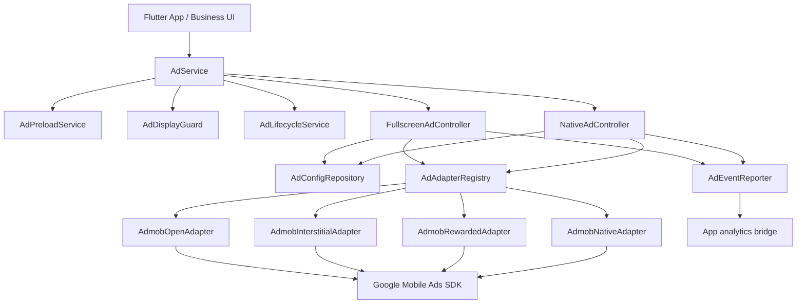

# 广告模块架构

## 目标

广告模块把业务调用和广告 SDK 解耦，业务层只关心广告位和展示结果，不直接持有 AdMob 的加载、缓存、回调和频控细节。

## 架构图

## 分层

- `AdService` 是业务唯一入口，负责初始化、预加载、展示和原生广告获取。
- `AdDisplayGuard` 负责全屏广告互斥、同广告位冷却和跨广告位冷却。
- `AdConfigRepository` 负责读取广告配置。抽取版默认从本地 Map 或构造参数传入的 JSON 读取，不绑定 Firebase。
- `FullscreenAdController` 管理 `open`、`interstitial`、`rewarded` 的加载、缓存和展示。
- `NativeAdController` 管理 `native` 的加载、缓存、展示语义和刷新。
- `AdAdapterRegistry` 按 `AdSource + AdType` 找到具体 SDK 适配器。
- `AdEventReporter` 统一发出 `adreq`、`adreq_succ`、`adreq_fail`、`ad_show`、`ad_show_succ`、`ad_show_fail`、`ad_colse` 等事件。

## Android 原生广告

Android 使用 `HomeNativeAdFactory` 注册 `factoryId = homeListTile`，对应：

- `android/app/src/main/kotlin/com/example/flutter_ad_plugin/HomeNativeAdFactory.kt`
- `android/app/src/main/res/layout/native_ad_home_card.xml`
- `android/app/src/main/res/drawable/native_ad_*.xml`

Dart 侧 `AdmobNativeAdapter` 创建 `NativeAd(factoryId: 'homeListTile')`，Flutter UI 侧通过 `NativeAdView` 内部的 `AdWidget` 展示。
