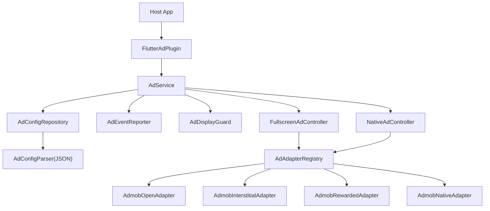

# 架构说明

## 目标

广告模块对宿主暴露稳定 API，配置与策略由 JSON 驱动，埋点由宿主注入。

## 架构图

## 动态规则

`AdConfigParser` 解析 JSON 后，运行时按配置动态决策：

- placement 候选能力：从该 placement 的 `type` 列表推导
- 展示策略：优先读 `placement_policy`，否则按候选类型推导默认值

这意味着宿主主要通过 JSON 控制行为，不再需要维护静态能力/策略表。

## iOS/Android 原生广告

- Android：`HomeNativeAdFactory.kt`
- iOS：`HomeNativeAdFactory.swift`
- 统一 `factoryId = homeListTile`
