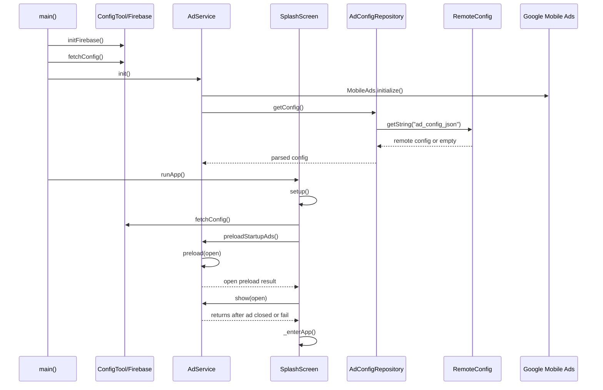
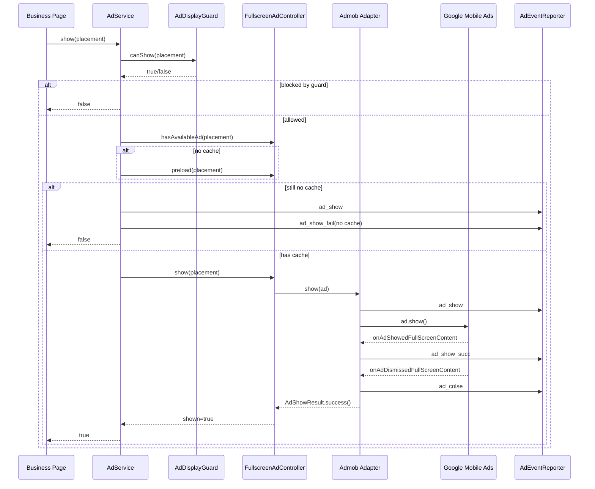
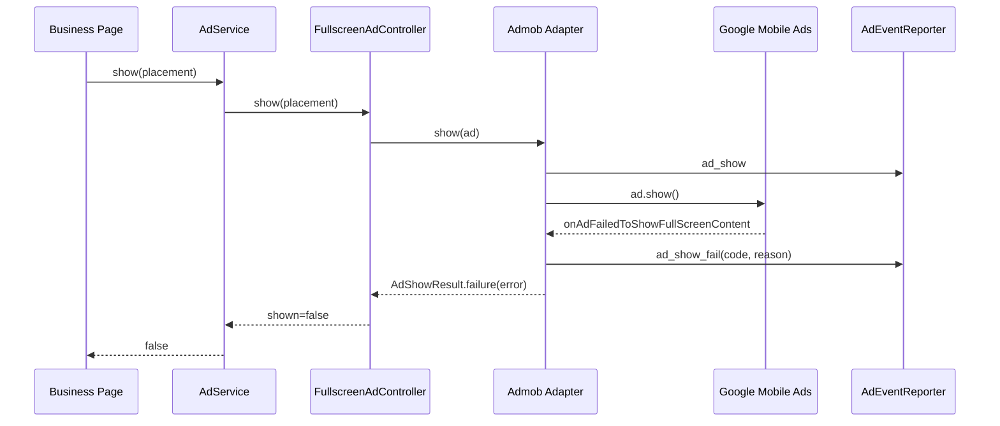
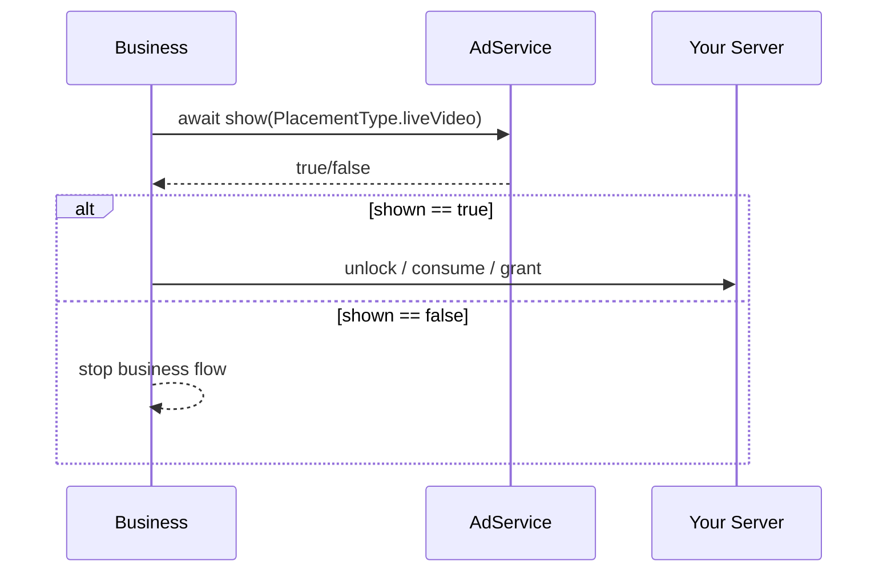
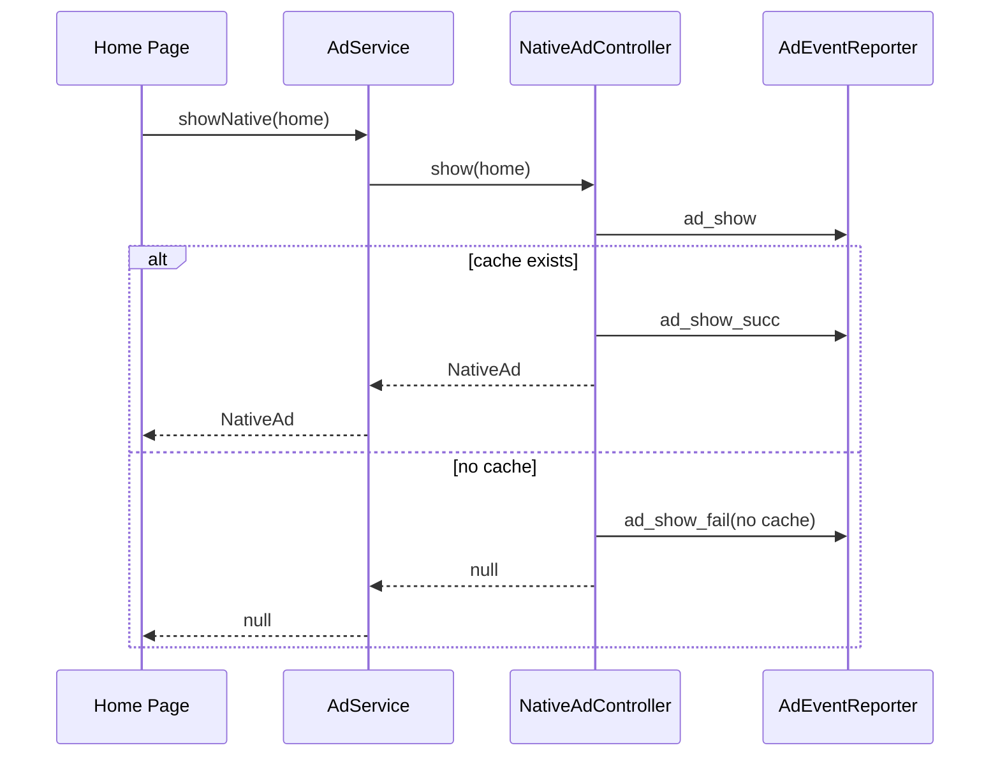
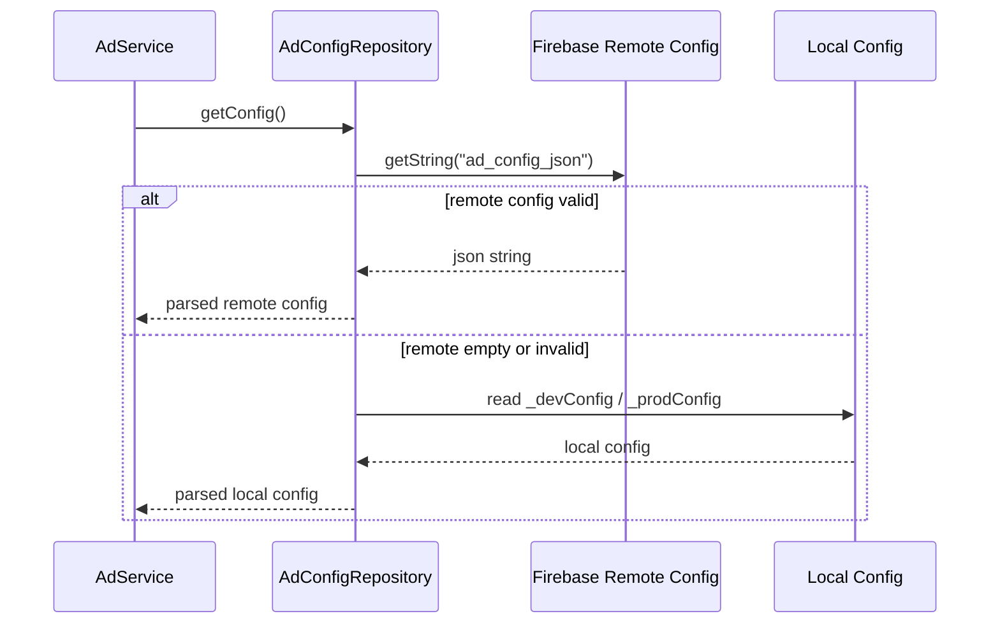

# Ad Sequence

## Overview

这份文档只描述时序，不重复解释架构分层。

关联文档：

- `/Users/ai3/Documents/siren/docs/ad_architecture.md`
- `/Users/ai3/Documents/siren/docs/ad_usage_guide.md`

## Startup Sequence



## Startup Notes

关键点：

- `main()` 只做基础初始化
- 开屏广告预加载放在 `SplashScreen`
- `preloadStartupAds()` 优先保证 `open`
- `show(open)` 返回后，再进入 `_enterApp()`

## Fullscreen Ad Show Sequence



## Fullscreen Failure Sequence



## Rewarded Business Sequence

当前业务层语义：

- 只关心广告是否显示成功
- 不关心 reward callback

推荐写法：



示例代码：

```dart
final shown = await AdService.instance.show(PlacementType.liveVideo);
if (!shown) return;
await unlockApi();
```

## Native Ad Sequence



## Config Loading Sequence



## Return Timing

`await AdService.instance.show(...)` 的返回时机：

- 成功展示时：广告关闭后返回 `true`
- 失败时：展示失败后返回 `false`
- 无缓存时：直接返回 `false`
- 频控拦截时：直接返回 `false`

因此下面代码是安全的：

```dart
await AdService.instance.show(PlacementType.open);
_enterApp();
```

它的真实含义是：

- 广告显示成功时，等广告结束再进入首页
- 广告显示失败时，直接进入首页

## Sequence Checklist

如果你要排查广告流程问题，按这个顺序看：

1. `main()` 是否完成 Firebase 初始化
2. Remote Config 是否拿到了 `ad_config_json`
3. 本地 JSON 是否已加入 assets
4. `SplashScreen` 是否触发了 `preloadStartupAds()`
5. `PlacementType.open` 是否真的有可用配置
6. `show()` 前是否被 guard 拦截
7. `ad_show` / `ad_show_succ` / `ad_show_fail` / `ad_colse` 是否按顺序上报
